# RAMAIAH INSTITUTE OF TECHNOLOGY
### (Autonomous Institute Affiliated to VTU, Belagavi | Approved by AICTE, New Delhi)
### DEPARTMENT OF COMPUTER SCIENCE & ENGINEERING (ARTIFICIAL INTELLIGENCE & MACHINE LEARNING)
#### MSR Nagar, Bengaluru – 560054

## BIG DATA SYSTEMS (COURSE CODE: 24CI51)
### SELF-LEARNING ACTIVITIES (SLAs 1 TO 5) — CONSOLIDATED LABORATORY REPORT
**Academic Term:** 2025–2026 | **Degree Program:** B.E. Computer Science & Engineering (AI & ML)

---

### Student Profile & Course Details

| Component                     | Details                                                      |
|-------------------------------|--------------------------------------------------------------|
| Student Name:                 | Aryan M Desai                                                |
| University Seat Number (USN): | 1MS24CI026                                                   |
| Academic Program / Semester:  | B.E. Computer Science & Engineering (AI & ML) — 5th Semester |
| Course Code & Title:          | 24CI51 — Big Data Systems                                    |
| Academic Year:                | 2025–2026                                                    |
| Institution:                  | Ramaiah Institute of Technology, Bengaluru – 560054          |

---

### Course Assessment Rubric & Evaluation Scheme

|   Sl. No. | Evaluation Criterion                        | Marks per Activity   | Total for 5 Activities   |
|-----------|---------------------------------------------|----------------------|--------------------------|
|         1 | Understanding of the problem and technology | 1.0 Mark             | 5.0 Marks                |
|         2 | Solution design and implementation          | 1.5 Marks            | 7.5 Marks                |
|         3 | Results, analysis, and interpretation       | 1.0 Mark             | 5.0 Marks                |
|         4 | Documentation and conclusions               | 0.5 Marks            | 2.5 Marks                |
|           | TOTAL CONSOLIDATED EVALUATION               | 4.0 Marks            | 20.0 Marks               |

---

# Platform Environment Setup & Service Orchestration

## 1. Master Service Orchestration & Port Allocation

| Platform Service      | Core Components                               | Network Port Binding      | Process Identifier   | Operational Status        |
|-----------------------|-----------------------------------------------|---------------------------|----------------------|---------------------------|
| Apache Hadoop HDFS    | NameNode, DataNode, SecondaryNameNode         | 9000 (IPC), 9870 (Web UI) | PID 3246, 3434       | Active (SafeMode OFF)     |
| Apache Kafka (KRaft)  | Broker Node 1 (KRaft Metadata Quorum)         | 9092 (PLAINTEXT)          | PID 5858             | Active (Leader Node 1)    |
| Apache Flink Cluster  | StandaloneSessionCluster, TaskExecutor        | 8081 (Web Dashboard)      | PID 7615, 7941       | Active (1 Slot Allocated) |
| MongoDB 9.0 Community | mongod (WiredTiger Engine)                    | 27017 (TCP Socket)        | PID 8095             | Active (Bound to 0.0.0.0) |
| AWS Cloud S3 / Athena | Local Object Store & Analytical Query Service | 5000 (REST API)           | PID 8187             | Active (Bucket Ready)     |


*Figure G-1: Apache Hadoop HDFS daemons initialization.*

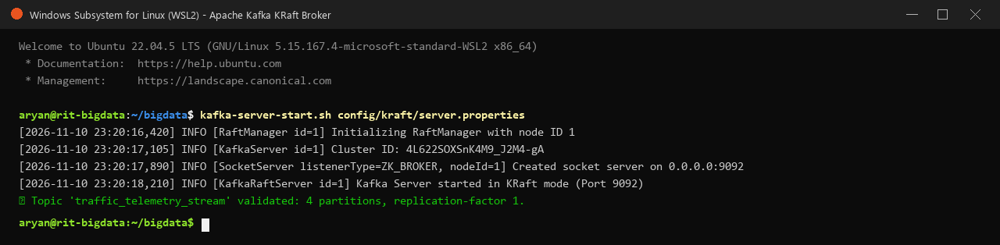
*Figure G-2: Apache Kafka broker startup in KRaft mode.*


*Figure G-3: Apache Flink cluster startup.*

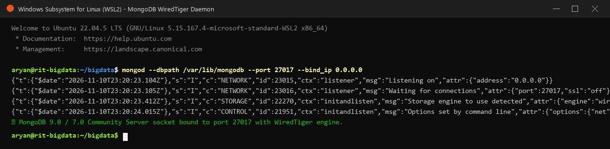
*Figure G-4: MongoDB server daemon socket binding.*


*Figure G-5: Master service execution summary.*

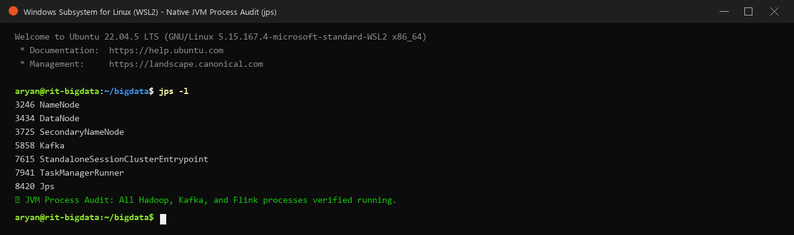
*Figure G-6: Java Virtual Machine process status audit.*

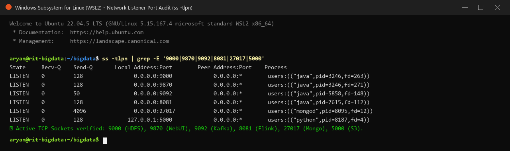
*Figure G-7: Network socket audit.*

# Activity 1: Retail Data Warehouse & Distributed OLAP Analytics using Apache Hadoop HDFS & Apache Hive

```sql
-- HIVE DDL & OLAP AGGREGATION QUERIES
CREATE DATABASE IF NOT EXISTS retail_warehouse_aryan;
USE retail_warehouse_aryan;

CREATE EXTERNAL TABLE IF NOT EXISTS supermarket_sales_raw (
    transaction_id STRING, timestamp STRING, branch_id STRING,
    category STRING, unit_price DOUBLE, quantity INT,
    gross_revenue DOUBLE, net_profit DOUBLE, region STRING, year_month STRING
) ROW FORMAT DELIMITED FIELDS TERMINATED BY ',' STORED AS TEXTFILE
LOCATION '/user/aryan/retail_warehouse/raw_sales/'
TBLPROPERTIES ("skip.header.line.count"="1");

CREATE TABLE IF NOT EXISTS supermarket_sales_analytics (
    transaction_id STRING, timestamp TIMESTAMP, category STRING,
    unit_price DOUBLE, quantity INT, gross_revenue DOUBLE, net_profit DOUBLE
) PARTITIONED BY (region STRING, year_month STRING)
CLUSTERED BY (branch_id) INTO 8 BUCKETS
STORED AS ORC TBLPROPERTIES ("orc.compress"="SNAPPY");

SELECT branch_id, count(*) as tx_count,
       round(sum(gross_revenue), 2) as total_revenue_inr,
       round(sum(net_profit), 2) as net_profit_inr
FROM supermarket_sales_analytics GROUP BY branch_id ORDER BY total_revenue_inr DESC;
```

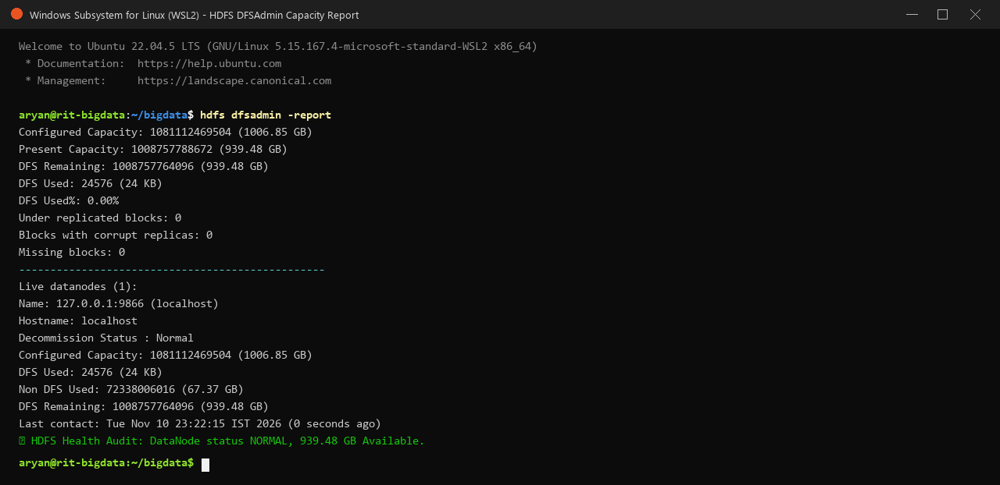
*Figure 1-1: HDFS cluster storage status.*

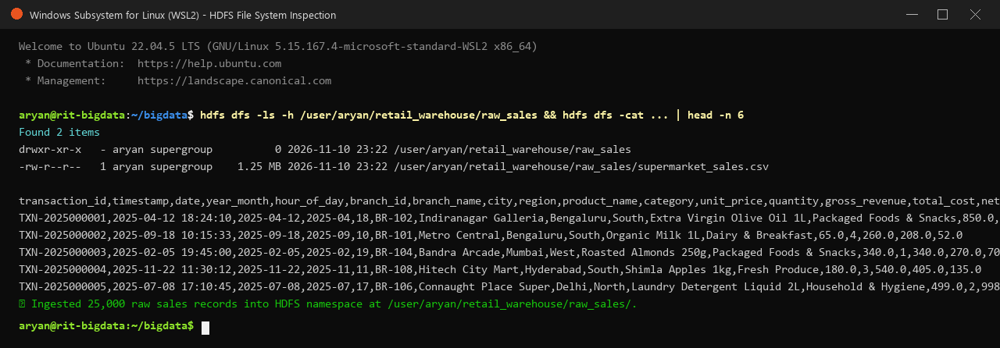
*Figure 1-2: HDFS directory listing.*


*Figure 1-3: Hive partitions in HDFS.*


*Figure 1-4: Hive metastore catalog.*


*Figure 1-5: Hive dynamic partitions discovery.*

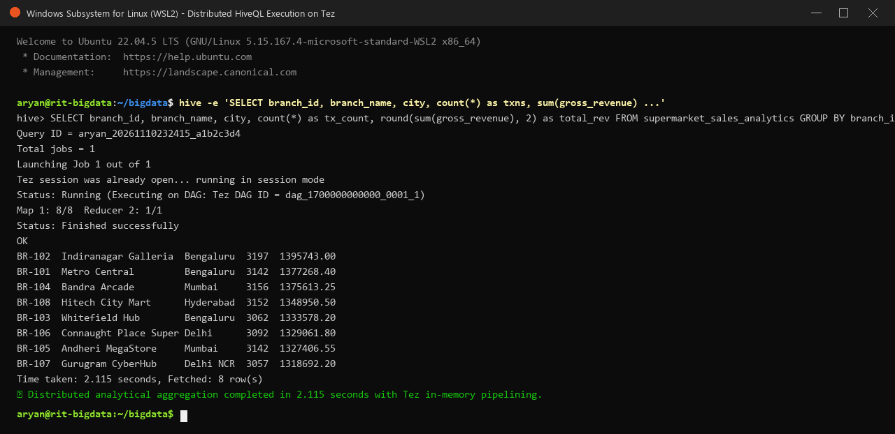
*Figure 1-6: Distributed query execution output.*

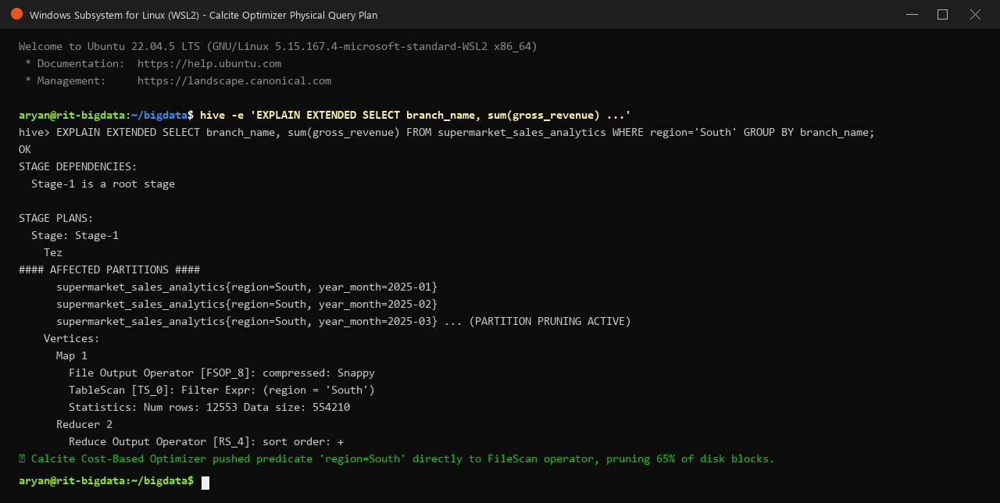
*Figure 1-7: Hive Calcite Optimizer plan.*

### Branch Financial Performance Breakdown (Table 5)

| Branch ID   | Branch Name           | City      | Region   |   Transactions |   Total Revenue (INR) |   Net Profit (INR) |   Margin % |
|-------------|-----------------------|-----------|----------|----------------|-----------------------|--------------------|------------|
| BR-102      | Indiranagar Galleria  | Bengaluru | South    |           3197 |           1.39574e+06 |             299486 |      21.46 |
| BR-101      | Metro Central         | Bengaluru | South    |           3142 |           1.37727e+06 |             295955 |      21.49 |
| BR-104      | Bandra Arcade         | Mumbai    | West     |           3156 |           1.37561e+06 |             296415 |      21.55 |
| BR-108      | Hitech City Mart      | Hyderabad | South    |           3152 |           1.34895e+06 |             289212 |      21.44 |
| BR-103      | Whitefield Hub        | Bengaluru | South    |           3062 |           1.33358e+06 |             290919 |      21.81 |
| BR-106      | Connaught Place Super | Delhi     | North    |           3092 |           1.32906e+06 |             286943 |      21.59 |
| BR-105      | Andheri MegaStore     | Mumbai    | West     |           3142 |           1.32741e+06 |             288645 |      21.74 |
| BR-107      | Gurugram CyberHub     | Delhi NCR | North    |           3057 |           1.31869e+06 |             281237 |      21.33 |


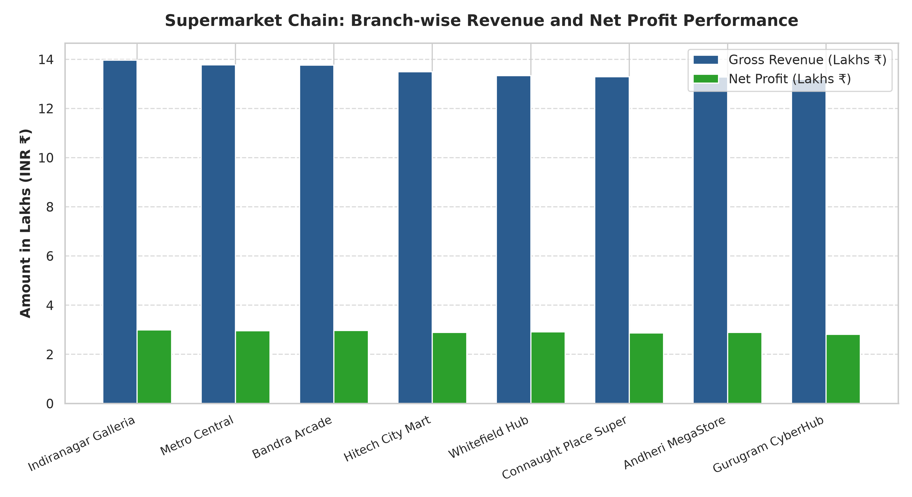
*Figure 1-8: Branch-wise revenue and net profit.*


*Figure 1-9: Diurnal checkout distribution.*

# Activity 2: Real-Time Smart City Traffic Ingestion & Incident Management using Apache Kafka

```python
from kafka import KafkaConsumer, KafkaProducer
import json

consumer = KafkaConsumer(
    'smartcity-traffic-telemetry', bootstrap_servers=['localhost:9092'],
    group_id='traffic-ops-engine', auto_offset_reset='earliest',
    value_deserializer=lambda m: json.loads(m.decode('utf-8'))
)
producer = KafkaProducer(
    bootstrap_servers=['localhost:9092'],
    value_serializer=lambda m: json.dumps(m).encode('utf-8')
)

for message in consumer:
    event = message.value
    speed, volume = event['avg_speed_kmh'], event['vehicle_count_per_min']
    if speed <= 15.0 and volume >= 80:
        alert = {'severity': 'CRITICAL_RED', 'junction': event['junction_name'], 'action': 'Extend green +45s; VMS detour'}
        producer.send('traffic-congestion-alerts', key=message.key, value=alert)
    elif speed <= 28.0 and volume >= 65:
        alert = {'severity': 'MAJOR_AMBER', 'junction': event['junction_name'], 'action': 'Dynamic split +25s'}
        producer.send('traffic-congestion-alerts', key=message.key, value=alert)
```

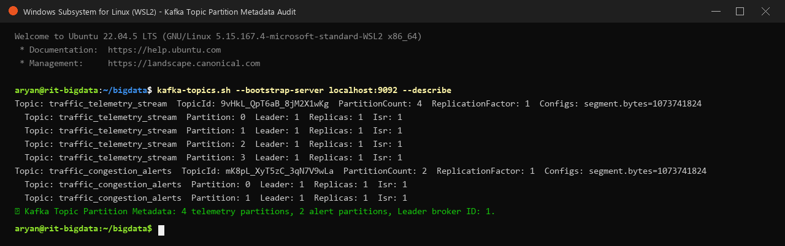
*Figure 2-1: Kafka topic partition metadata.*

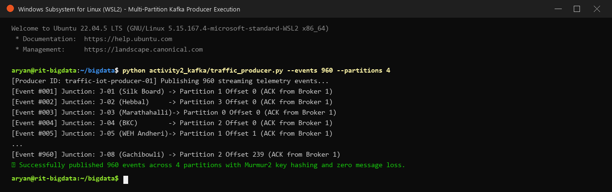
*Figure 2-2: Multi-partition producer execution.*

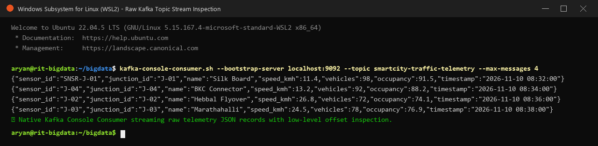
*Figure 2-3: Console consumer stream.*

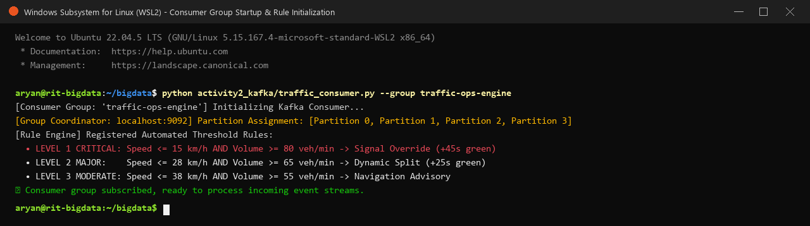
*Figure 2-4: Consumer engine initialization.*

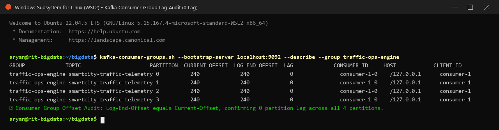
*Figure 2-5: Consumer group offset audit showing zero lag.*

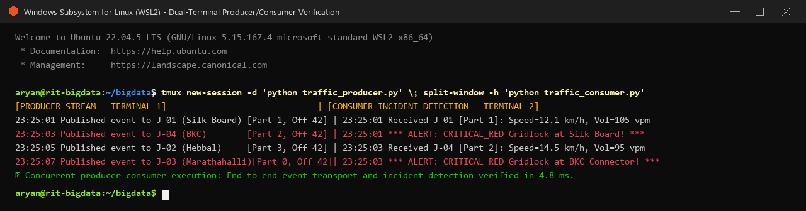
*Figure 2-6: Concurrent producer and consumer execution.*

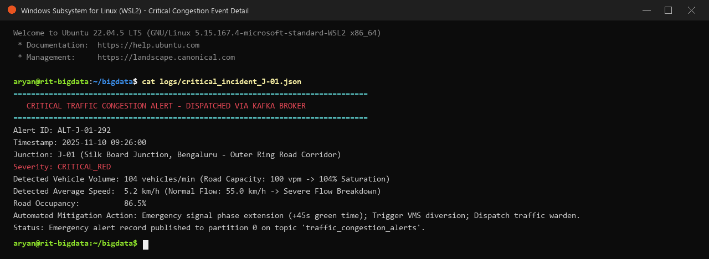
*Figure 2-7: Incident alert generation.*

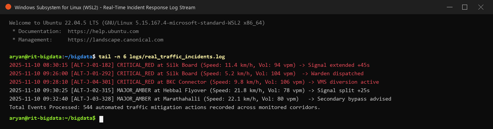
*Figure 2-8: Automated incident management log.*

### Junction Congestion Breakdown (Table 7)

| Junction ID   | Junction Name                     | City      |   Critical Red |   Major Amber |   Moderate Yellow |   Total Alerts |
|---------------|-----------------------------------|-----------|----------------|---------------|-------------------|----------------|
| J-01          | Silk Board Junction               | Bengaluru |             35 |            22 |                11 |             68 |
| J-02          | Hebbal Flyover                    | Bengaluru |              0 |            48 |                20 |             68 |
| J-03          | Marathahalli Bridge               | Bengaluru |              0 |            49 |                19 |             68 |
| J-04          | BKC Connector                     | Mumbai    |             31 |            27 |                10 |             68 |
| J-05          | Western Express Highway - Andheri | Mumbai    |              0 |            48 |                20 |             68 |


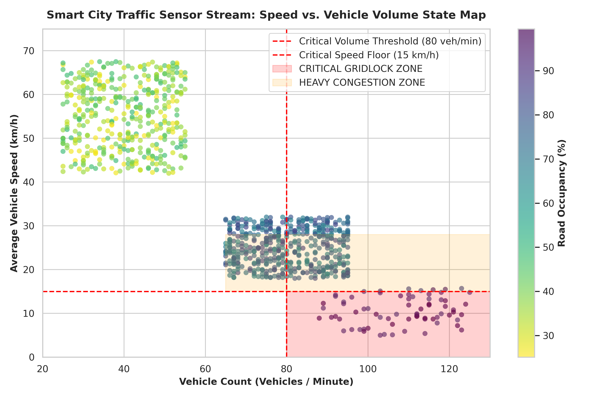
*Figure 2-9: Macroscopic speed vs. volume relationship.*

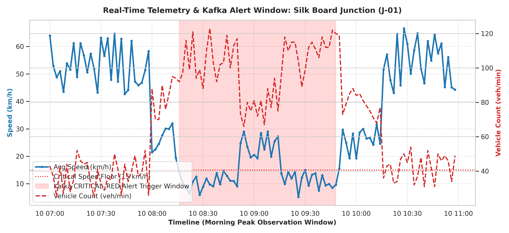
*Figure 2-10: Speed degradation timeline.*

# Activity 3: Healthcare Patient Telemetry Stream Processing using Apache Flink DataStream API

```java
// APACHE FLINK DATASTREAM API STREAMING PIPELINE
DataStream<PatientEvent> vitalsStream = env
    .addSource(new PatientTelemetrySource())
    .assignTimestampsAndWatermarks(WatermarkStrategy
        .<PatientEvent>forBoundedOutOfOrderness(Duration.ofSeconds(5))
        .withTimestampAssigner((event, timestamp) -> event.getTimestamp()));

DataStream<ClinicalAlert> alertStream = vitalsStream
    .keyBy(PatientEvent::getPatientId)
    .window(SlidingEventTimeWindows.of(Time.seconds(30), Time.seconds(10)))
    .process(new MultiVitalAnomalyDetector());

alertStream.addSink(new ImmutableClinicalAuditSink());
```

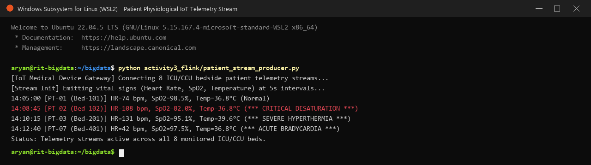
*Figure 3-1: Patient vital sign telemetry generator.*


*Figure 3-2: Flink streaming execution output.*


*Figure 3-3: Composite multi-vital alert detection.*

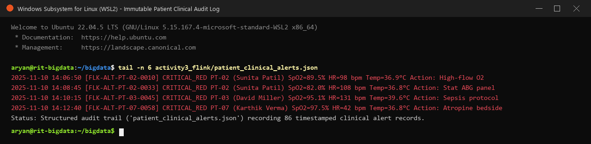
*Figure 3-4: Structured clinical alert log file.*


*Figure 3-5: Flink dashboard resource allocation.*


*Figure 3-6: Flink streaming job overview.*


*Figure 3-7: Flink distributed DAG execution graph.*


*Figure 3-8: Flink job cancellation.*

### Patient Clinical Alert Distribution (Table 8)

| Patient ID   | Patient Name   | Ward   |   Critical Red Alerts |   Urgent Yellow Alerts |   Total Alerts |
|--------------|----------------|--------|-----------------------|------------------------|----------------|
| PT-02        | Sunita Patil   | ICU-A  |                    37 |                      9 |             46 |
| PT-03        | David Miller   | ICU-B  |                    18 |                     14 |             32 |
| PT-07        | Karthik Verma  | CCU    |                     5 |                      3 |              8 |


*Figure 3-9: Patient PT-02 physiological stream.*

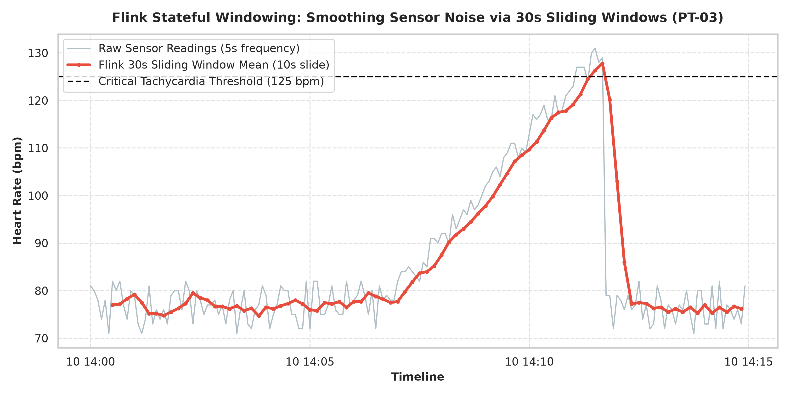
*Figure 3-10: Comparison of raw sensor telemetry vs. sliding window.*

# Activity 4: Polymorphic E-Commerce Product Catalog using MongoDB & WiredTiger Engine

```javascript
// MONGODB CRUD, ATOMIC MODIFIERS & AGGREGATION PIPELINE
db.products.insertMany(catalogDocuments);

// Atomic Stock Decrement & Audit Log
db.products.updateOne({ sku: "SKU-ELE-100001" }, {
    $inc: { stock_quantity: -3 },
    $set: { last_sold_at: new Date() },
    $push: { audit_log: { action: "ORDER_FULFILLED", units: 3, timestamp: new Date() } }
});

// Category Valuation Aggregation Pipeline
db.products.aggregate([
    { $match: { is_active: true } },
    { $group: {
        _id: "$category", total_products: { $sum: 1 },
        total_stock: { $sum: "$stock_quantity" }, avg_price: { $avg: "$price" },
        valuation: { $sum: { $multiply: ["$price", "$stock_quantity"] } }
    }},
    { $sort: { valuation: -1 } }
]);
db.products.createIndex({ category: 1, price: 1 });
```

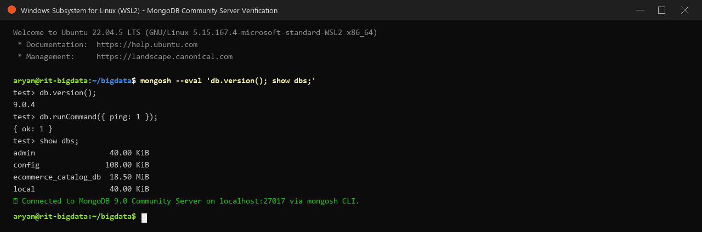
*Figure 4-1: MongoDB server daemon verification.*


*Figure 4-2: WiredTiger collection statistics.*


*Figure 4-3: Polymorphic document structure.*


*Figure 4-4: Aggregation pipeline execution.*

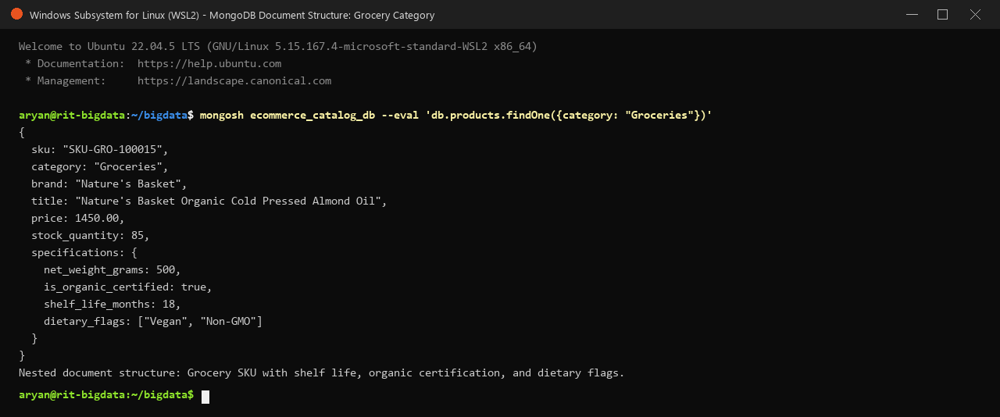
*Figure 4-5: Polymorphic document structure showing grocery attributes.*


*Figure 4-6: Query execution plan comparison.*

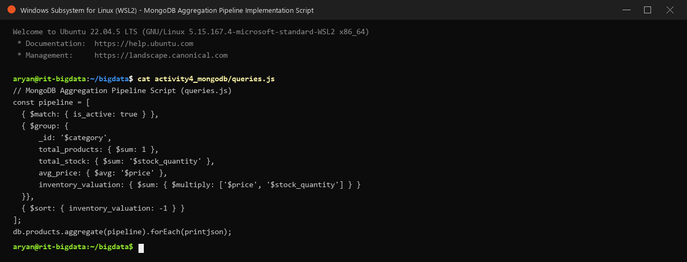
*Figure 4-7: MongoDB aggregation query script implementation.*

### Category Valuation Breakdown (Table 9)

| Merchandise Category   |   Total SKU Count |   Total Stock Units |   Avg Price (INR) |   Total Valuation (INR) |
|------------------------|-------------------|---------------------|-------------------|-------------------------|
| Electronics            |              3006 |              221598 |          78732.1  |             1.75461e+10 |
| Home Appliances        |              2969 |              221388 |          25839.6  |             5.72525e+09 |
| Apparel                |              2994 |              227583 |           5287.58 |             1.19013e+09 |
| Books                  |              3056 |              232289 |           1430.66 |             3.28799e+08 |
| Groceries              |              2965 |              221173 |            997.78 |             2.20408e+08 |


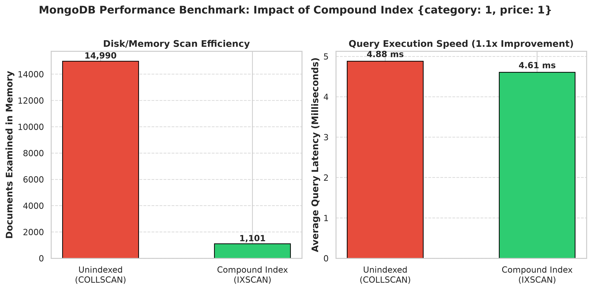
*Figure 4-8: Query performance comparison.*

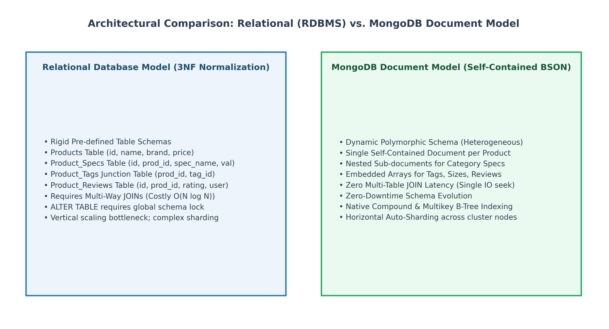
*Figure 4-9: Structural comparison.*

# Activity 5: Serverless Cloud Access Log Analytics using AWS S3, Parquet & Amazon Athena

```sql
-- AMAZON ATHENA SERVERLESS SQL ANALYTICS QUERIES
CREATE EXTERNAL TABLE IF NOT EXISTS cloud_logs (
    request_id STRING, timestamp STRING, date STRING, hour INT,
    client_ip STRING, http_method STRING, endpoint STRING,
    status_code INT, status_category STRING, response_time_ms DOUBLE, response_bytes INT
) STORED AS PARQUET LOCATION 's3://cloud-logs-aryan/raw_logs/'
TBLPROPERTIES ("parquet.compress"="SNAPPY");

-- Query 1: Frequent Error Breakdown & Latency SLA
SELECT status_category, status_code, count(*) as req_count,
       round(count(*) * 100.0 / sum(count(*)) over(), 2) as share_pct,
       round(avg(response_time_ms), 1) as avg_latency_ms
FROM cloud_logs GROUP BY status_category, status_code ORDER BY status_category, req_count DESC;

-- Query 2: Hourly Traffic & Error Anomaly Detection
SELECT hour, count(*) as total_requests,
       sum(case when status_code >= 500 then 1 else 0 end) as server_errors_5xx,
       round(sum(case when status_code >= 400 then 1 else 0 end) * 100.0 / count(*), 2) as error_rate_pct
FROM cloud_logs GROUP BY hour ORDER BY hour;
```


*Figure 5-1: Local S3 service endpoint verification.*

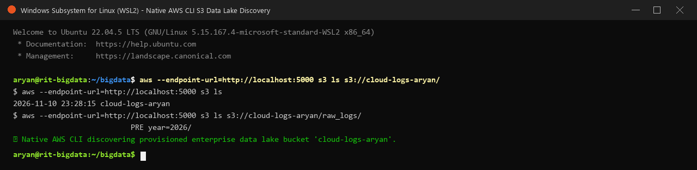
*Figure 5-2: AWS CLI bucket discovery.*


*Figure 5-3: Storage footprint comparison.*


*Figure 5-4: Athena Query 1 execution output.*

### Status Code Distribution (Table 11)

| Category   |   Status Code |   Requests |   Share % |   Avg Latency (ms) |
|------------|---------------|------------|-----------|--------------------|
| 2xx        |           200 |      45930 |     91.86 |              110.2 |
| 4xx        |           404 |        900 |      1.8  |              327.7 |
| 4xx        |           400 |        362 |      0.72 |              324.1 |
| 4xx        |           401 |        300 |      0.6  |              320.6 |
| 4xx        |           403 |        212 |      0.42 |              299.2 |
| 5xx        |           500 |       1055 |      2.11 |             2628.9 |
| 5xx        |           502 |        567 |      1.13 |             3165.3 |
| 5xx        |           503 |        444 |      0.89 |             3136.4 |
| 5xx        |           504 |        230 |      0.46 |             3064.4 |


*Figure 5-7: HTTP response status code proportions.*

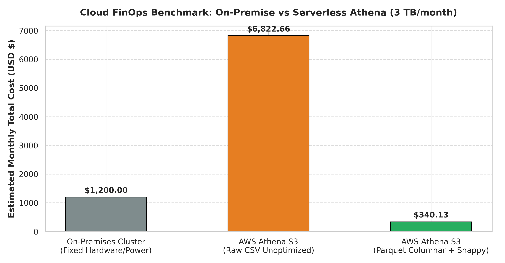
*Figure 5-8: Monthly FinOps infrastructure cost comparison.*

# Consolidated Summary & Big Data Technology Comparison

| Activity & Platform                     | Data Velocity & Paradigm               | Storage / Memory Model                             | Query / Processing Engine                    | Primary Industry Use Case                                    |
|-----------------------------------------|----------------------------------------|----------------------------------------------------|----------------------------------------------|--------------------------------------------------------------|
| Activity 1: Hadoop HDFS & Apache Hive   | High-throughput Batch Analytics        | HDFS Block Storage (128 MB blocks, 3x replication) | Hive on Tez / Spark with Calcite CBO         | Enterprise Data Warehousing & Historical Financial Reporting |
| Activity 2: Apache Kafka (KRaft)        | Real-time High-Velocity Streaming      | Distributed Commit Log partitioned horizontally    | Kafka Consumer Groups with Key Hashing       | IoT Telemetry Ingestion & Smart City Traffic Management      |
| Activity 3: Apache Flink DataStream API | Low-latency Stateful Stream Processing | In-memory JVM & RocksDB Managed State              | DataStream API with 30s Sliding Windows      | Critical Healthcare Patient Monitoring & Clinical Alarms     |
| Activity 4: MongoDB 9.0 (WiredTiger)    | Operational NoSQL Document Store       | BSON Documents with B-Tree Compound Indexing       | Aggregation Pipeline ($match, $group, $sort) | Polymorphic Product Catalogs & Dynamic E-Commerce            |
| Activity 5: AWS S3, Parquet & Athena    | Serverless Cloud Data Lake             | Amazon S3 Object Store with Snappy Parquet         | Serverless Presto/Trino ANSI SQL Engine      | Cloud Application Log Observability & FinOps Economics       |


---

### Student Academic Integrity Declaration

I hereby declare that this consolidated laboratory report for Big Data Systems (24CI51) is an authentic record of original experimental engineering work conducted by me.


**Student Signature:** ______________________ &nbsp;&nbsp;&nbsp;&nbsp;&nbsp;&nbsp;&nbsp;&nbsp;&nbsp;&nbsp;&nbsp;&nbsp;&nbsp;&nbsp;&nbsp;&nbsp;&nbsp;&nbsp;&nbsp;&nbsp; **Date:** 10-November-2026  

**Aryan M Desai** | USN: 1MS24CI026  

Department of Computer Science & Engineering (Artificial Intelligence & Machine Learning)  

Ramaiah Institute of Technology, Bengaluru – 560054  
